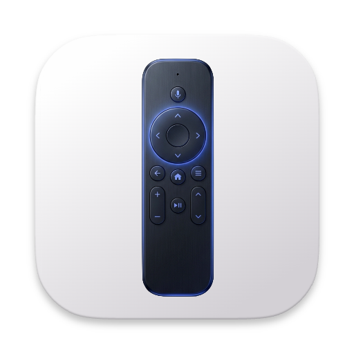
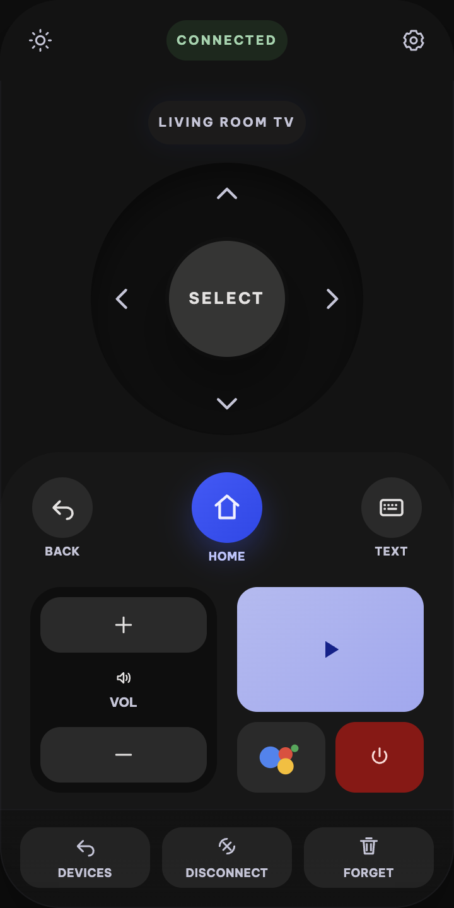
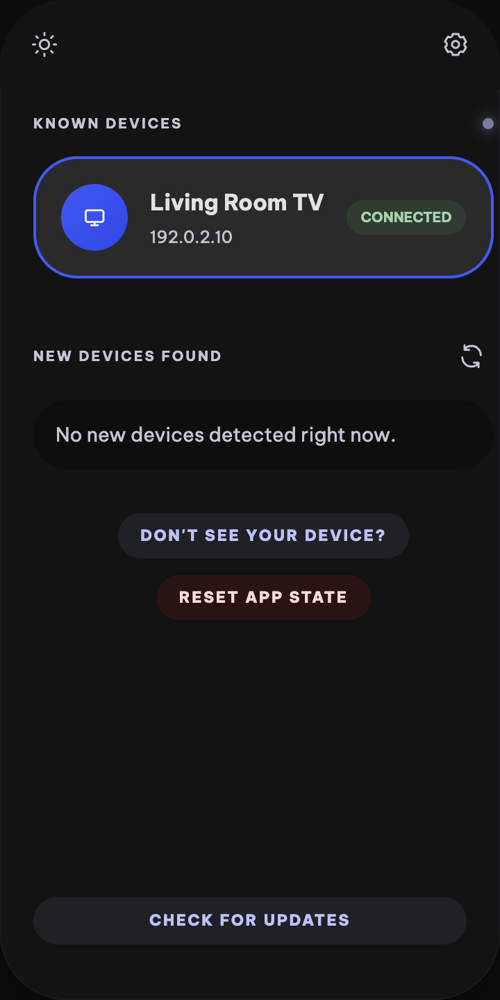

<div align="center">
  

  <h1>GTV Desktop Remote</h1>

  <p><strong>A macOS desktop remote for Google TV and Android TV devices.</strong><br/>
  Discover, pair once, and control your TV from your Mac — with keyboard support.</p>

  <p>
    <a href="https://github.com/usrivastava92/gtv-desktop-remote/actions/workflows/ci.yml">
      
    </a>
    <a href="https://github.com/usrivastava92/gtv-desktop-remote/releases/latest">
      
    </a>
    <a href="https://github.com/usrivastava92/gtv-desktop-remote/releases/latest">
      
    </a>
    
    
    <a href="LICENSE">
      
    </a>
    <a href="https://scorecard.dev/status/github.com/usrivastava92/gtv-desktop-remote">
      
    </a>
  </p>
</div>

---

## Overview

GTV Desktop Remote lets you control any Google TV or Android TV device from your Mac. It runs as a menubar app — always one keystroke away — and uses the same encrypted pairing protocol as the official Android TV Remote app.

- **Network scan** — discovers compatible devices on your local network automatically
- **One-time pairing** — enter a 6-digit code once; credentials are saved securely
- **Full remote control** — navigation, select, home, back, play/pause, volume, power
- **Keyboard control** — drive your TV from the keyboard without touching the mouse
- **Text input** — send text directly to apps that support Android TV text entry
- **IP-change resilient** — device identity is tracked by MAC address, not IP, so re-pairing is never needed when your TV's IP changes
- **Global shortcut** — customizable show/hide shortcut (default `CmdOrCtrl+Shift+G`)
- **Launch at login** — optional macOS Login Item, off by default

### Local multi-TV spike

This branch adds Apple TV and Fire TV alongside the existing Google TV/Android TV
provider without renaming the application or replacing its remote layout.
Discovery labels each platform and routes pairing and controls through the
app-owned `TvProvider` contract.

- Google TV retains its six-character pairing flow and microphone support.
- Apple TV requests two successive four-digit PINs: AirPlay, then Companion.
- Fire TV requests one four-digit PIN. For DIAL-discovered devices, Pair and Connect
  explicitly launch the remote service and wait for its native port before HTTPS.
  Scanning never activates the service. Volume and microphone controls are disabled;
  navigation, playback toggle, power toggle, and text entry use its native library.
- Apple TV microphone controls are disabled in this spike. Text entry on every
  platform requires a compatible focused TV input field.
- Apple/Fire credentials are encrypted with Electron `safeStorage`, kept outside
  device metadata, and require an available OS keychain. Fire TV uses HTTPS by
  default with self-signed receiver certificates accepted; use only a trusted LAN.
- Apple TV uses a pinned local library patch with portable ChaCha20-Poly1305,
  because Electron's Node crypto backend does not expose that cipher. Pairing
  and Companion frames retain their authentication checks; no cipher downgrade
  or external Node installation is used.

Physical Apple TV and Fire TV discovery was observed in the packaged app.
Fire TV protocol regressions use an independent local HTTP/HTTPS receiver, not
Fire OS. Physical Fire service activation and the native four-digit PIN request
were also exercised successfully; PIN verification, saved-token reconnection and
authenticated Fire controls remain unverified on hardware. Apple pairing,
authenticated reconnection and native Home tap/hold dispatch were exercised
against a physical Apple TV. The operator confirmed that holding H or Home opens
Control Center. No TV-screen capture was taken; full hardware coverage is pending.
See [the provider extension contract](DEVELOPMENT.md#multi-tv-provider-contract)
and [test fidelity limits](tests/integration/README.md#multi-tv-spike).

---

## Screenshots

<div align="center">
  <table>
    <tr>
      <td align="center" width="50%">
        
        <br />
        <sub><strong>Remote controls</strong></sub>
      </td>
      <td align="center" width="50%">
        
        <br />
        <sub><strong>Device management</strong></sub>
      </td>
    </tr>
  </table>
</div>

---

## Installation

Download the latest `.dmg` from the [Releases](https://github.com/usrivastava92/gtv-desktop-remote/releases/latest) page, open it, and drag the app to your Applications folder.

If you install from the `.dmg`, macOS may block the app on first launch because it was downloaded from the internet. If that happens:

1. Open **System Settings** → **Privacy & Security**.
2. Scroll to the **Security** section.
3. Click **Open Anyway** for GTV Remote.
4. Confirm the prompt and launch the app again.

Or install with Homebrew:

```bash
brew install --cask usrivastava92/tap/gtv-desktop-remote
```

The Homebrew cask removes the quarantine flag automatically during install and prints fallback steps if macOS still blocks launch.

> **Requirement:** macOS. Your TV must have Android TV Remote Service enabled and be on the same local network as your Mac.

---

## Getting Started

1. Launch the app — it appears in your menu bar.
2. The app scans your network for compatible devices.
3. Select your TV from the device list.
4. If not yet paired, click **Start Pairing** and enter the 6-character code shown on your TV.
5. Once paired, click **Connect** — you're ready to use the remote.

The app remembers paired devices, so future connections are instant.

### Remote appearance

Click the sun in the device-list or remote header to switch to light theme, or the moon to return to dark theme. Dark is the default; your choice is remembered across launches and also applies to Settings. The remote header uses a centered, subtly green **Connected** pill for an active connection and a neutral pill while connecting; the device-list header has no connection pill.

### Finding, hiding, and quitting the remote

On first launch, a dismissible **Welcome to GTV Remote** hint explains where the app lives. Click **Got it** to acknowledge it; it will not appear again on later launches.

- Look for the GTV Remote icon in the **menu bar** at the top of your screen. The app does not stay in the Dock.
- Click the menu-bar icon to show or hide the remote, or use the global shortcut shown in the welcome hint.
- In this multi-TV spike, the remote stays visible when you click away or switch apps. Hide it explicitly with the menu-bar icon or global shortcut.
- Right-click the menu-bar icon for **Show Remote**, **Hide Remote**, and **Quit**. Choose **Quit** to exit completely, rather than just hide the window.

---

## Keyboard Shortcuts

When the remote is focused and connected, your keyboard controls the TV directly:

| Key                    | Action       |
| ---------------------- | ------------ |
| `↑` `↓` `←` `→`        | Navigate     |
| `Enter`                | Select / OK  |
| `Escape` / `Backspace` | Back         |
| `H`                    | Home         |
| `Space` / `K`          | Play / Pause |
| `+` / `=`              | Volume Up    |
| `-` / `_`              | Volume Down  |
| `P`                    | Power        |

For **Apple TV Control Center**, hold `H` or press and hold the on-screen **Home**
button for about **1.5 seconds**. A short tap remains Home. Long press is enabled
only for providers that advertise it; Google TV and Fire TV keep their existing
Home behavior. Keyboard auto-repeat does not generate extra Apple Home presses.

> `Cmd`, `Ctrl`, and `Option` combinations are ignored so they don't interfere with normal macOS shortcuts.

**Global shortcut:** `CmdOrCtrl+Shift+G` by default — show or hide the remote from any app.

### Settings

Settings replaces the remote or device list while open. Click **Done** or press **Escape** to return; longer settings and error messages scroll inside the app window.

Click the gear at the far right of the device, pairing, or remote header to open **Settings**. Enable or disable **Launch at login** in the installed macOS app; development Electron is never added to Login Items. It is off by default, and macOS **System Settings → General → Login Items** remains authoritative. Opening Settings refreshes the current macOS state, including external changes made while the app is running, without re-enabling a disabled item. If macOS readback fails, the toggle shows an unknown state and an error; reopen Settings to retry.

Click or focus the show/hide shortcut control, then press and release the actual keys and click **Save shortcut**. For example, hold Control and Option and press G on Mac to record **Ctrl+Opt+G** (**Ctrl+Alt+G** on Windows), then release G to finish recording. Meta is displayed as **Cmd** on Mac and **Win** on Windows. Use modifiers plus a letter, digit, or F1–F24; at least one modifier must be other than Shift. Modifier presses preview the combination; unsupported keys explain what is supported. After a supported chord is pressed, the control previews it and asks you to release the keys; recording finishes only when that chord's letter, digit, or function key is released. **Escape** cancels recording without closing Settings; **Tab**, leaving the control, or closing the view also cancels, including while a captured key is still held. While recording, this app temporarily releases its global shortcut so recording that same chord cannot hide the window, then restores it after the captured key is released or recording is cancelled. If another app takes the binding during recording, Settings reports that it could not be restored rather than claiming it is active; the menu bar remains usable. Recorded shortcuts are stored internally in Electron accelerator format, not display labels, and saved across restarts. A failed replacement keeps the previous working shortcut. If the saved shortcut is occupied on startup, Settings shows the problem; the menu bar still opens the remote.

---

## Troubleshooting

**TV not appearing in the scan?**

- Confirm the TV and Mac are on the same Wi-Fi network.
- Confirm Android TV Remote Service is enabled on the TV.
- Try re-running the network scan.

**Pairing not completing?**

- Start a fresh pairing session and enter the latest code shown on the TV screen.
- Pairing codes contain six hexadecimal characters (`0–9`, `A–F`); `O` is not a valid character.
- After a certificate-hash validation error, select the device again to request a fresh code. If the error persists with the exact new code, report the app version and TV model/firmware.
- If the device was previously saved, remove it and pair again.

**App not opening or only showing the menubar icon?**

- If macOS blocks launch, use **System Settings** → **Privacy & Security** → **Open Anyway**.
- If the menubar icon appears but the window does not, click the menubar icon or press `Cmd+Shift+G`.
- If it still fails, attach the app log from `~/Library/Application Support/GTV Remote/gtv-remote.log` to your issue.
- Also include your macOS version, Mac model/processor, install method (`.dmg`, Homebrew, or source), and whether the menubar icon appears.

---

## For Developers

Development setup, packaging, debug telemetry, and local build workflows are documented in [DEVELOPMENT.md](DEVELOPMENT.md).

After dependency setup and `yarn build`, `yarn test:integration` runs the real Electron functional regression guardrail without a live TV. It uses isolated temporary profiles, genuine certificate-bound TLS pairing, an independent TV protocol/model emulator, production fake-device microphone capture and sandbox updater install/rollback operations. See [integration setup, the feature-to-scenario matrix and narrow hardware/native fidelity limits](tests/integration/README.md). The mandatory CI functional job runs under Linux Xvfb; this guardrail is not a firmware-interoperability or native macOS signing/permissions guarantee.
