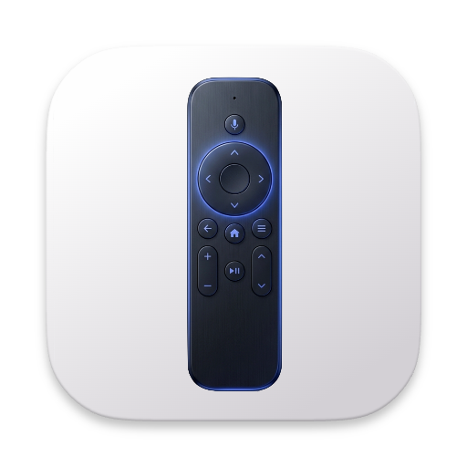
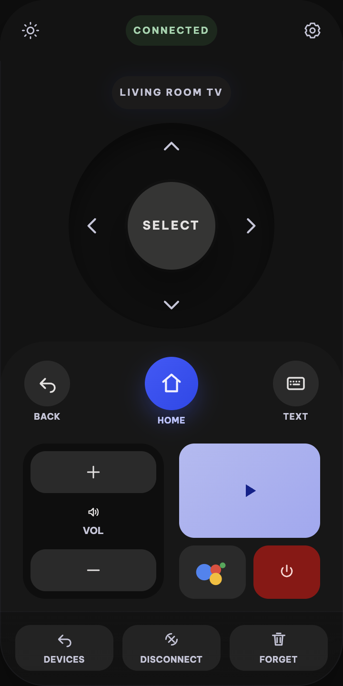
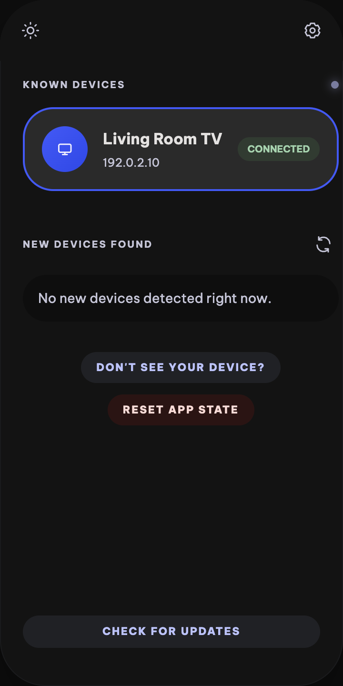

<div align="center">
  

  <h1>GTV Desktop Remote</h1>

  <p><strong>A desktop remote for Google TV, Apple TV, and Fire TV.</strong><br/>
  Discover, pair, and control compatible TVs from your Mac - with keyboard support.</p>

  <p>
    <a href="https://github.com/usrivastava92/gtv-desktop-remote/actions/workflows/ci.yml">
      
    </a>
    <a href="https://github.com/usrivastava92/gtv-desktop-remote/releases/latest">
      
    </a>
    <a href="https://github.com/usrivastava92/gtv-desktop-remote/releases/latest">
      
    </a>
    
    
    <a href="LICENSE">
      
    </a>
    <a href="https://scorecard.dev/status/github.com/usrivastava92/gtv-desktop-remote">
      
    </a>
  </p>
</div>

---

## Overview

GTV Desktop Remote is a macOS menubar app for compatible Google TV/Android TV, Apple TV, and Fire TV devices on your local network.

- **Network scan** - discovers supported platforms and labels each device
- **Saved pairing** - platform-specific pairing with reconnect credentials retained across launches
- **Remote control** - navigation, select, home, back, playback and supported power/volume controls
- **Keyboard control** - drive your TV from the keyboard without touching the mouse
- **Text input** - send text to compatible focused TV input fields
- **Stable device identity** - supported discovery identifiers can retain pairing after an IP change; reconnect is explicit, and identity availability depends on the TV
- **Global shortcut** - customizable show/hide shortcut (default `CmdOrCtrl+Shift+G`)
- **Launch at login** - optional macOS Login Item, off by default

### Platform support

| Capability                                 | Google TV / Android TV                            | Apple TV                                                | Fire TV            |
| ------------------------------------------ | ------------------------------------------------- | ------------------------------------------------------- | ------------------ |
| Pairing                                    | One six-character hexadecimal code (`0–9`, `A–F`) | Two successive four-digit PINs: AirPlay, then Companion | One four-digit PIN |
| Navigation, select, Home, back, play/pause | Supported                                         | Supported                                               | Supported          |
| Power toggle                               | Supported                                         | Supported                                               | Supported          |
| Volume up/down                             | Supported                                         | Supported                                               | **Unsupported**    |
| Text entry in compatible focused fields    | Supported                                         | Supported                                               | Supported          |
| Microphone / assistant voice               | Supported                                         | **Unsupported**                                         | **Unsupported**    |
| Home hold for Control Center               | Unsupported                                       | Supported                                               | Unsupported        |

“Supported” describes implemented provider capabilities, not a guarantee for every
TV model, app or firmware. Unsupported controls are disabled.

For DIAL-discovered Fire TVs, explicit Pair and Connect launch the remote service
and wait for its native TCP port before HTTPS. Scanning never activates it.
**Use Fire TV only on a trusted LAN:** HTTPS accepts self-signed receiver
certificates by default, without certificate-chain verification or certificate
pinning. Encryption alone does not authenticate the receiver; there is no
automatic fallback to unencrypted HTTP.

Apple TV and Fire TV reconnect credentials are encrypted with Electron
`safeStorage` using the OS keychain, outside device metadata; there is no plaintext
fallback. After both Apple PIN stages, macOS may request Keychain permission to
save credentials. This is not a request for your Apple account password.
Google TV retains its existing PEM certificate/private-key store; these PEM files
are **not** encrypted by `safeStorage`.

Upgrading keeps the **GTV Remote** app name, bundle identity, repository, installer
names and `~/Library/Application Support/GTV Remote` data location. Existing
Google-only saved records remain Google TV records and keep their credentials;
do not reset or remove devices as part of a normal upgrade.

Physical Apple TV and Fire TV discovery was historically observed in the packaged
app. Apple pairing, authenticated reconnection and native Home tap/hold dispatch
were exercised against a physical Apple TV; the operator confirmed that holding H
or Home opened Control Center. No TV-screen capture was taken. Physical Fire
service activation and the four-digit PIN request were observed, but **Fire PIN
validation, saved-token reconnection and authenticated controls remain unverified
on hardware**. Local protocol tests are not firmware validation. See the
[provider contract](DEVELOPMENT.md#multi-tv-provider-contract) and
[test fidelity limits](tests/integration/README.md#multi-tv-providers).

---

## Screenshots

<div align="center">
  <table>
    <tr>
      <td align="center" width="50%">
        
        <br />
        <sub><strong>Remote controls</strong></sub>
      </td>
      <td align="center" width="50%">
        
        <br />
        <sub><strong>Device management</strong></sub>
      </td>
    </tr>
  </table>
</div>

---

## Installation

Download the latest `.dmg` from the [Releases](https://github.com/usrivastava92/gtv-desktop-remote/releases/latest) page, open it, and drag the app to your Applications folder.

If you install from the `.dmg`, macOS may block the app on first launch because it was downloaded from the internet. If that happens:

1. Open **System Settings** → **Privacy & Security**.
2. Scroll to the **Security** section.
3. Click **Open Anyway** for GTV Remote.
4. Confirm the prompt and launch the app again.

Or install with Homebrew:

```bash
brew install --cask usrivastava92/tap/gtv-desktop-remote
```

The Homebrew cask removes the quarantine flag automatically during install and prints fallback steps if macOS still blocks launch.

> **Requirement:** macOS and a compatible TV on the same trusted local network. Google TV/Android TV requires Android TV Remote Service; Apple TV and Fire TV require their supported local-network remote services. Discovery can be blocked by guest-network isolation or multicast restrictions.

---

## Getting Started

1. Launch the app - it appears in your menu bar.
2. The app scans your network for compatible devices.
3. Select your TV from the device list.
4. If not yet paired, click **Start Pairing**. Google TV uses six hexadecimal characters; Apple TV asks for an AirPlay four-digit PIN followed by a **new** Companion four-digit PIN; Fire TV asks for one four-digit PIN. Always enter the code currently displayed for that stage.
5. Click **Continue** after entering each pairing code. After the final stage, the app connects automatically so you can use the remote.

The app remembers paired devices for future connections. Reconnect can still fail
if a TV revokes pairing, its service is unavailable, or macOS denies credential
access. Do not enter an Apple account password into a TV PIN field.

### Remote appearance

Click the sun in the device-list or remote header to switch to light theme, or the moon to return to dark theme. Dark is the default; your choice is remembered across launches and also applies to Settings. The remote header uses a centered, subtly green **Connected** pill for an active connection and a neutral pill while connecting; the device-list header has no connection pill.

### Finding, hiding, and quitting the remote

On first launch, a dismissible **Welcome to GTV Remote** hint explains where the app lives. Click **Got it** to acknowledge it; it will not appear again on later launches.

- Look for the GTV Remote icon in the **menu bar** at the top of your screen. The app does not stay in the Dock.
- Click the menu-bar icon to show or hide the remote, or use the global shortcut shown in the welcome hint.
- The remote stays visible when you click away or switch apps. Hide it explicitly with the menu-bar icon or global shortcut.
- Right-click the menu-bar icon for **Show Remote**, **Hide Remote**, and **Quit**. Choose **Quit** to exit completely, rather than just hide the window.

---

## Keyboard Shortcuts

When the remote is focused and connected, your keyboard controls the TV directly:

| Key                    | Action       |
| ---------------------- | ------------ |
| `↑` `↓` `←` `→`        | Navigate     |
| `Enter`                | Select / OK  |
| `Escape` / `Backspace` | Back         |
| `H`                    | Home         |
| `Space` / `K`          | Play / Pause |
| `+` / `=`              | Volume Up    |
| `-` / `_`              | Volume Down  |
| `P`                    | Power        |

For **Apple TV Control Center**, hold `H` or press and hold the on-screen **Home**
button for about **1.5 seconds**. A short tap remains Home. Long press is enabled
only for providers that advertise it; Google TV and Fire TV keep their existing
Home behavior. Keyboard auto-repeat does not generate extra Apple Home presses.

> `Cmd`, `Ctrl`, and `Option` combinations are ignored so they don't interfere with normal macOS shortcuts.

**Global shortcut:** `CmdOrCtrl+Shift+G` by default - show or hide the remote from any app.

### Settings

Settings replaces the remote or device list while open. Click **Done** or press **Escape** to return; longer settings and error messages scroll inside the app window.

Click the gear at the far right of the device, pairing, or remote header to open **Settings**. Enable or disable **Launch at login** in the installed macOS app; development Electron is never added to Login Items. It is off by default, and macOS **System Settings → General → Login Items** remains authoritative. Opening Settings refreshes the current macOS state, including external changes made while the app is running, without re-enabling a disabled item. If macOS readback fails, the toggle shows an unknown state and an error; reopen Settings to retry.

Click or focus the show/hide shortcut control, then press and release the actual keys and click **Save shortcut**. For example, hold Control and Option and press G on Mac to record **Ctrl+Opt+G** (**Ctrl+Alt+G** on Windows), then release G to finish recording. Meta is displayed as **Cmd** on Mac and **Win** on Windows. Use modifiers plus a letter, digit, or F1–F24; at least one modifier must be other than Shift. Modifier presses preview the combination; unsupported keys explain what is supported. After a supported chord is pressed, the control previews it and asks you to release the keys; recording finishes only when that chord's letter, digit, or function key is released. **Escape** cancels recording without closing Settings; **Tab**, leaving the control, or closing the view also cancels, including while a captured key is still held. While recording, this app temporarily releases its global shortcut so recording that same chord cannot hide the window, then restores it after the captured key is released or recording is cancelled. If another app takes the binding during recording, Settings reports that it could not be restored rather than claiming it is active; the menu bar remains usable. Recorded shortcuts are stored internally in Electron accelerator format, not display labels, and saved across restarts. A failed replacement keeps the previous working shortcut. If the saved shortcut is occupied on startup, Settings shows the problem; the menu bar still opens the remote.

---

## Troubleshooting

**TV not appearing in the scan?**

- Confirm the TV and Mac are on the same Wi-Fi network.
- For Google TV/Android TV, confirm Android TV Remote Service is enabled. For Apple/Fire, confirm the TV is awake and its local-network services are available.
- Try re-running the network scan.

**Pairing not completing?**

- Start a fresh pairing session and enter the latest code shown on the TV screen.
- Google TV codes contain six hexadecimal characters (`0–9`, `A–F`); `O` is not valid. Apple and Fire PINs contain four decimal digits; Apple requires two separate stages.
- After a Google certificate-hash validation error, select the device again to request a fresh code. If it persists with the exact new code, report the app version and TV model/firmware.
- For Apple/Fire credential-save errors, check macOS Keychain access. Credentials are not saved in plaintext as a fallback.
- Removing a saved device deletes its local credentials and requires pairing again; use this only when deliberately replacing a revoked or unusable pairing, not as a routine upgrade step.

**App not opening or only showing the menubar icon?**

- If macOS blocks launch, use **System Settings** → **Privacy & Security** → **Open Anyway**.
- If the menubar icon appears but the window does not, click the menubar icon or press `Cmd+Shift+G`.
- If it still fails, attach the app log from `~/Library/Application Support/GTV Remote/gtv-remote.log` to your issue.
- Also include your macOS version, Mac model/processor, install method (`.dmg`, Homebrew, or source), and whether the menubar icon appears.

---

## For Developers

Development setup, packaging, debug telemetry, and local build workflows are documented in [DEVELOPMENT.md](DEVELOPMENT.md).

After dependency setup and `yarn build`, `yarn test:integration` runs the real Electron functional regression guardrail without a live TV. It uses isolated temporary profiles, genuine certificate-bound TLS pairing, an independent TV protocol/model emulator, production fake-device microphone capture and sandbox updater install/rollback operations. See [integration setup, the feature-to-scenario matrix and narrow hardware/native fidelity limits](tests/integration/README.md). The mandatory CI functional job runs under Linux Xvfb; this guardrail is not a firmware-interoperability or native macOS signing/permissions guarantee.

---

## Support development

[](https://github.com/sponsors/usrivastava92)

GTV Desktop Remote remains free and open source. If it makes your day a little easier,
voluntary support through **GitHub Sponsors** helps with maintenance, device testing,
and Apple Developer Program costs toward Developer ID-signed and notarized macOS packages.
We're also exploring Mac App Store distribution, subject to technical feasibility and
Apple review, not a promised release. Thanks for helping keep the remote going!
